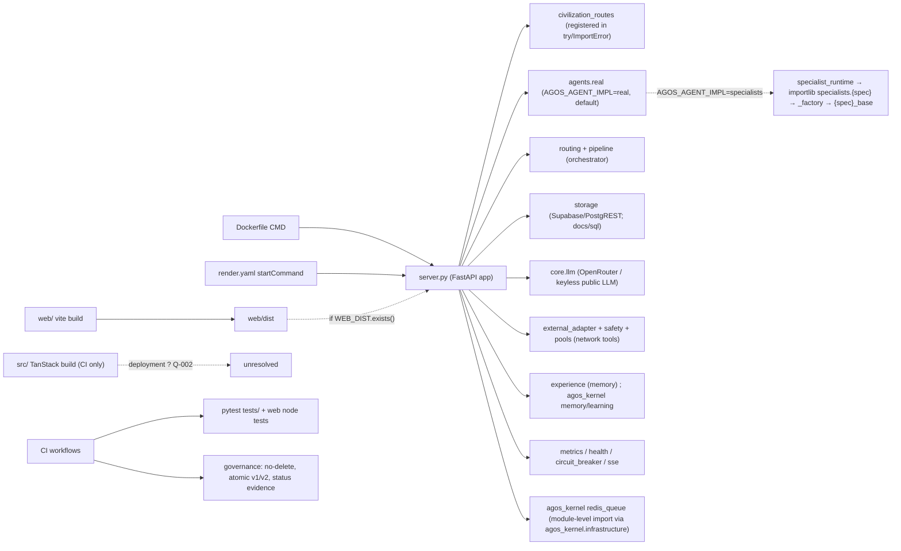

# خريطة المسارات ونقاط الدخول — اللقطة `caab69b` (R-156)

> **مُولَّدة آلياً** من `scripts/build_entrypoint_map.py` — لا تُحرَّر يدوياً. إعادة الإنتاج:
>
> `python3 scripts/build_entrypoint_map.py . caab69b2d9aa59614856923512f2e10ccca0954f docs/governance/roadmaps/revival-scale/maps/ENTRYPOINT_MAP_caab69b.json --md docs/governance/roadmaps/revival-scale/maps/ENTRYPOINT_MAP_caab69b.md`

- اللقطة: `caab69b2d9aa59614856923512f2e10ccca0954f` (مقروءة من كائنات git). البيانات الكاملة: [`ENTRYPOINT_MAP_caab69b.json`](ENTRYPOINT_MAP_caab69b.json).
- ملفات متعقبة 1887؛ Python 1190؛ ملفات شيفرة حُللت 1221؛ حواف 7007 (conditional=10، dynamic=71، lazy=292، top=6634).
- نقاط دخول 60 (ci-job=9، cli=26، cli-toplevel=14، frontend-root=4، frontend-web=2، server=2، shell=1، tests=2)؛ مسارات HTTP 24؛ متغيرات بيئة 57.
- إغلاق الخادم الساكن: 34 ملفاً على مستوى الوحدة، 90 مع الاستيرادات الكسولة/الشرطية/الديناميكية.
- **تمييز الأدلة**: `auto:*` مستخرج آلياً ومتحقق منه بالتشغيل في `tests/test_r156_entrypoint_map.py`؛ `declared`/`convention` تجميع أو عرف يحتاج مراجعة بشرية (القسم الأخير). **لا تُدّعى تغطية دلالية كاملة.**
- مشكلات الفحص الذاتي: 0

## المخطط

> المخطط ملخص بشري (`declared`) لحواف `auto:*` في JSON؛ المرجع هو JSON.

## نقاط الدخول

| المعرف | النوع | الهدف | الدليل |
|---|---|---|---|
| `deploy:docker-cmd` | server | `server.py` | auto — Dockerfile:28 |
| `deploy:render-start` | server | `server.py` | auto — render.yaml |
| `cli:agent_civilization/registry/oss_agents.py` | cli | `agent_civilization/registry/oss_agents.py` | auto — agent_civilization/registry/oss_agents.py (if __name__ == '__main__') |
| `cli:agent_civilization/routing/auto_router.py` | cli | `agent_civilization/routing/auto_router.py` | auto — agent_civilization/routing/auto_router.py (if __name__ == '__main__') |
| `cli:docs/audit/M6/logs/raw/117_r112b_continuation.py` | cli | `docs/audit/M6/logs/raw/117_r112b_continuation.py` | auto — docs/audit/M6/logs/raw/117_r112b_continuation.py (if __name__ == '__main__') |
| `cli:docs/audit/M6/logs/raw/118_r112b_supplement.py` | cli | `docs/audit/M6/logs/raw/118_r112b_supplement.py` | auto — docs/audit/M6/logs/raw/118_r112b_supplement.py (if __name__ == '__main__') |
| `cli:docs/audit/M7/scripts/r121_memory_diag.py` | cli | `docs/audit/M7/scripts/r121_memory_diag.py` | auto — docs/audit/M7/scripts/r121_memory_diag.py (if __name__ == '__main__') |
| `cli:run.py` | cli | `run.py` | auto — run.py (if __name__ == '__main__') |
| `cli:scripts/build_file_inventory.py` | cli | `scripts/build_file_inventory.py` | auto — scripts/build_file_inventory.py (if __name__ == '__main__') |
| `cli:scripts/check_atomic_batch.py` | cli | `scripts/check_atomic_batch.py` | auto — scripts/check_atomic_batch.py (if __name__ == '__main__') |
| `cli:scripts/check_no_delete.py` | cli | `scripts/check_no_delete.py` | auto — scripts/check_no_delete.py (if __name__ == '__main__') |
| `cli:scripts/check_status_evidence.py` | cli | `scripts/check_status_evidence.py` | auto — scripts/check_status_evidence.py (if __name__ == '__main__') |
| `cli:scripts/r042/kong_prefix_proxy.py` | cli | `scripts/r042/kong_prefix_proxy.py` | auto — scripts/r042/kong_prefix_proxy.py (if __name__ == '__main__') |
| `cli:scripts/r042/make_jwt.py` | cli | `scripts/r042/make_jwt.py` | auto — scripts/r042/make_jwt.py (if __name__ == '__main__') |
| `cli:scripts/r132_server_probe.py` | cli | `scripts/r132_server_probe.py` | auto — scripts/r132_server_probe.py (if __name__ == '__main__') |
| `cli:scripts/run_r042_storage_verify.py` | cli | `scripts/run_r042_storage_verify.py` | auto — scripts/run_r042_storage_verify.py (if __name__ == '__main__') |
| `cli:scripts/run_r051_audit.py` | cli | `scripts/run_r051_audit.py` | auto — scripts/run_r051_audit.py (if __name__ == '__main__') |
| `cli:scripts/run_r053_scale_audit.py` | cli | `scripts/run_r053_scale_audit.py` | auto — scripts/run_r053_scale_audit.py (if __name__ == '__main__') |
| `cli:scripts/run_r055_scenarios.py` | cli | `scripts/run_r055_scenarios.py` | auto — scripts/run_r055_scenarios.py (if __name__ == '__main__') |
| `cli:scripts/run_r100_safety_probe.py` | cli | `scripts/run_r100_safety_probe.py` | auto — scripts/run_r100_safety_probe.py (if __name__ == '__main__') |
| `cli:scripts/run_r102_handler_probe.py` | cli | `scripts/run_r102_handler_probe.py` | auto — scripts/run_r102_handler_probe.py (if __name__ == '__main__') |
| `cli:scripts/run_r108_sustained_load.py` | cli | `scripts/run_r108_sustained_load.py` | auto — scripts/run_r108_sustained_load.py (if __name__ == '__main__') |
| `cli:scripts/run_r109_live_hour.py` | cli | `scripts/run_r109_live_hour.py` | auto — scripts/run_r109_live_hour.py (if __name__ == '__main__') |
| `cli:scripts/run_r119_live_hour.py` | cli | `scripts/run_r119_live_hour.py` | auto — scripts/run_r119_live_hour.py (if __name__ == '__main__') |
| `cli:scripts/run_r131_http_load.py` | cli | `scripts/run_r131_http_load.py` | auto — scripts/run_r131_http_load.py (if __name__ == '__main__') |
| `cli:scripts/sec05/probe_dns_rebinding.py` | cli | `scripts/sec05/probe_dns_rebinding.py` | auto — scripts/sec05/probe_dns_rebinding.py (if __name__ == '__main__') |
| `cli:scripts/sec06/probe_public_llm.py` | cli | `scripts/sec06/probe_public_llm.py` | auto — scripts/sec06/probe_public_llm.py (if __name__ == '__main__') |
| `cli:server.py` | cli | `server.py` | auto — server.py (if __name__ == '__main__') |
| `script:scripts/bug01/probe_external_without_agent.py` | cli-toplevel | `scripts/bug01/probe_external_without_agent.py` | auto — module-level script (no __main__ guard) |
| `script:scripts/bug02/probe_chat_status.py` | cli-toplevel | `scripts/bug02/probe_chat_status.py` | auto — module-level script (no __main__ guard) |
| `script:scripts/bug03/probe_readiness.py` | cli-toplevel | `scripts/bug03/probe_readiness.py` | auto — module-level script (no __main__ guard) |
| `script:scripts/bug04/probe_task_by_id.py` | cli-toplevel | `scripts/bug04/probe_task_by_id.py` | auto — module-level script (no __main__ guard) |
| `script:scripts/r042/run_local_stack.sh` | shell | `scripts/r042/run_local_stack.sh` | auto — shell script |
| `script:scripts/run_r071_web_verify.py` | cli-toplevel | `scripts/run_r071_web_verify.py` | auto — module-level script (no __main__ guard) |
| `script:scripts/run_r075_roadmap_audit.py` | cli-toplevel | `scripts/run_r075_roadmap_audit.py` | auto — module-level script (no __main__ guard) |
| `script:scripts/run_r078_key_probe.py` | cli-toplevel | `scripts/run_r078_key_probe.py` | auto — module-level script (no __main__ guard) |
| `script:scripts/run_r082_storage_failure_probe.py` | cli-toplevel | `scripts/run_r082_storage_failure_probe.py` | auto — module-level script (no __main__ guard) |
| `script:scripts/run_r083_metrics_probe.py` | cli-toplevel | `scripts/run_r083_metrics_probe.py` | auto — module-level script (no __main__ guard) |
| `script:scripts/run_r085_metrics_load.py` | cli-toplevel | `scripts/run_r085_metrics_load.py` | auto — module-level script (no __main__ guard) |
| `script:scripts/run_r103_experience_probe.py` | cli-toplevel | `scripts/run_r103_experience_probe.py` | auto — module-level script (no __main__ guard) |
| `script:scripts/run_r131_compare.py` | cli-toplevel | `scripts/run_r131_compare.py` | auto — module-level script (no __main__ guard) |
| `script:scripts/run_r132_pool_report.py` | cli-toplevel | `scripts/run_r132_pool_report.py` | auto — module-level script (no __main__ guard) |
| `script:scripts/sec04/probe_sse.py` | cli-toplevel | `scripts/sec04/probe_sse.py` | auto — module-level script (no __main__ guard) |
| `tests:pytest` | tests | `tests/` | auto — pytest.ini testpaths=tests |
| `tests:web-node` | tests | `web/tests/` | auto — web/package.json scripts.test |
| `build:web/package.json` | frontend-web | `web` | auto — web/package.json |
| `build:package.json` | frontend-root | `.` | auto — package.json |
| `frontend:web/index.html` | frontend-web | `web/index.html` | auto — web/index.html + server.py WEB_DIST |
| `frontend:src/router.tsx` | frontend-root | `src/router.tsx` | convention (needs_human_review) — vite.config.ts / package.json |
| `frontend:src/start.ts` | frontend-root | `src/start.ts` | convention (needs_human_review) — vite.config.ts / package.json |
| `frontend:src/server.ts` | frontend-root | `src/server.ts` | convention (needs_human_review) — vite.config.ts / package.json |
| `ci:.github/workflows/ci.yml#audit` | ci-job | `.github/workflows/ci.yml` | auto — .github/workflows/ci.yml:256 |
| `ci:.github/workflows/ci.yml#build` | ci-job | `.github/workflows/ci.yml` | auto — .github/workflows/ci.yml:71 |
| `ci:.github/workflows/ci.yml#docker` | ci-job | `.github/workflows/ci.yml` | auto — .github/workflows/ci.yml:129 |
| `ci:.github/workflows/ci.yml#network` | ci-job | `.github/workflows/ci.yml` | auto — .github/workflows/ci.yml:375 |
| `ci:.github/workflows/ci.yml#publish` | ci-job | `.github/workflows/ci.yml` | auto — .github/workflows/ci.yml:397 |
| `ci:.github/workflows/ci.yml#quality` | ci-job | `.github/workflows/ci.yml` | auto — .github/workflows/ci.yml:10 |
| `ci:.github/workflows/ci.yml#storage` | ci-job | `.github/workflows/ci.yml` | auto — .github/workflows/ci.yml:320 |
| `ci:.github/workflows/ci.yml#test` | ci-job | `.github/workflows/ci.yml` | auto — .github/workflows/ci.yml:33 |
| `ci:.github/workflows/governance-gate.yml#governance` | ci-job | `.github/workflows/governance-gate.yml` | auto — .github/workflows/governance-gate.yml:14 |

## مسارات HTTP (من AST)

| الطريقة | المسار | المعالج | الملف:السطر | النطاق/الشرط | التبعيات |
|---|---|---|---|---|---|
| GET | `/civilization/registry` | registry_route | `agent_civilization/civilization_routes.py:54` | lazy — inside def register_civilization_routes() | api_key_header |
| POST | `/civilization/plan` | preview_plan | `agent_civilization/civilization_routes.py:63` | lazy — inside def register_civilization_routes() | api_key_header |
| POST | `/civilization/execute` | execute | `agent_civilization/civilization_routes.py:69` | lazy — inside def register_civilization_routes() | api_key_header |
| GET | `/api` | api_root | `server.py:424` | top | — |
| GET | `/health` | health_check | `server.py:450` | top | — |
| GET | `/health/live` | liveness_probe | `server.py:487` | top | — |
| GET | `/health/ready` | readiness_probe | `server.py:497` | top | — |
| GET | `/metrics` | prometheus_metrics | `server.py:535` | top | — |
| GET | `/api/system/status` | system_status | `server.py:588` | top | — |
| GET | `/api/agents` | list_agents | `server.py:636` | top | — |
| GET | `/api/specializations` | list_specializations | `server.py:646` | top | — |
| POST | `/api/tasks` | create_task | `server.py:664` | top | api_key_header |
| GET | `/api/tasks` | list_tasks | `server.py:707` | top | api_key_header |
| GET | `/api/tasks/{task_id}` | get_task | `server.py:723` | top | api_key_header |
| GET | `/api/memory` | get_memory | `server.py:748` | top | api_key_header |
| GET | `/api/learning` | get_learning | `server.py:758` | top | api_key_header |
| DELETE | `/api/memory` | clear_memory | `server.py:767` | top | api_key_header |
| GET | `/api/events` | list_events | `server.py:783` | top | api_key_header |
| GET | `/api/events/stream` | event_stream | `server.py:813` | top | api_key_header |
| POST | `/api/chat` | chat | `server.py:864` | top | api_key_header |
| POST | `/api/agents/external` | register_external_agent | `server.py:945` | top | api_key_header |
| DELETE | `/api/agents/external/{name}` | remove_external_agent | `server.py:979` | top | api_key_header |
| MOUNT | `/assets` | — | `server.py:1013` | conditional — if WEB_DIST.exists() | — |
| GET | `/{full_path:path}` | serve_frontend | `server.py:1016` | conditional — if WEB_DIST.exists() | — |

## النشر والبناء

- Dockerfile: مراحل ['frontend-build', 'python:3.12-slim']؛ CMD `["sh", "-c", "uvicorn server:app --host 0.0.0.0 --port ${PORT}"]`؛ COPY: `web/package.json`، `web/package-lock.json`، `web/`، `requirements.txt`، `requirements.lock`، `.`، `/app/web/dist`
- render.yaml: build `pip install --require-hashes -r requirements.lock && cd web && npm ci --engine-strict --no-audit --no-fund && npm run build`؛ start `uvicorn server:app --host 0.0.0.0 --port $PORT`

## وظائف CI

- `.github/workflows/ci.yml` ‏**audit** (سطر 256): مسارات مستخدمة: `requirements-audit.lock`, `requirements.lock`
- `.github/workflows/ci.yml` ‏**build** (سطر 71): مسارات مستخدمة: —
- `.github/workflows/ci.yml` ‏**docker** (سطر 129): مسارات مستخدمة: —
- `.github/workflows/ci.yml` ‏**network** (سطر 375): مسارات مستخدمة: `requirements-dev.lock`, `requirements.lock`
- `.github/workflows/ci.yml` ‏**publish** (سطر 397): مسارات مستخدمة: —
- `.github/workflows/ci.yml` ‏**quality** (سطر 10): مسارات مستخدمة: `server.py`
- `.github/workflows/ci.yml` ‏**storage** (سطر 320): مسارات مستخدمة: `requirements-dev.lock`, `requirements.lock`, `scripts/r042/run_local_stack.sh`
- `.github/workflows/ci.yml` ‏**test** (سطر 33): مسارات مستخدمة: `requirements-dev.lock`, `requirements.lock`
- `.github/workflows/governance-gate.yml` ‏**governance** (سطر 14): مسارات مستخدمة: `agent_civilization/civilization_routes`, `agent_civilization/storage/`, `docs/audit/`, `docs/governance/API.md`, `docs/governance/CHANGELOG.md`, `docs/governance/DATA_MODEL.md`, `docs/governance/PROJECT_STATE.md`, `docs/governance/QUALITY.md`, `docs/governance/ROADMAP.md`, `scripts/check_atomic_batch.py`, `scripts/check_no_delete.py`, `scripts/check_status_evidence.py`

## الأنظمة الفرعية والعقود

### api

- الملفات (تجميع `declared`): `server.py`, `agent_civilization/civilization_routes.py`
- في إغلاق الخادم الساكن: `server.py`=True, `agent_civilization/civilization_routes.py`=True
- مسارات: GET /civilization/registry, POST /civilization/plan, POST /civilization/execute, GET /api, GET /health, GET /health/live, GET /health/ready, GET /metrics, GET /api/system/status, GET /api/agents, GET /api/specializations, POST /api/tasks, GET /api/tasks, GET /api/tasks/{task_id}, GET /api/memory, GET /api/learning, DELETE /api/memory, GET /api/events, GET /api/events/stream, POST /api/chat, POST /api/agents/external, DELETE /api/agents/external/{name}, MOUNT /assets, GET /{full_path:path}
- متغيرات بيئة: `AGENTS_PER_SPEC`, `AGOS_ALLOWED_ORIGINS`, `AGOS_API_KEY`, `AGOS_RATE_LIMIT_REQUESTS`, `AGOS_RATE_LIMIT_WINDOW`, `PORT`
- واجهة عامة: `server.py`: verify_api_key, require_principal, require_admin, check_rate_limit, rate_limit, TaskRequest, ChatRequest, ExternalAgentRequest, api_root, health_check, liveness_probe, readiness_probe, prometheus_metrics, system_status, list_agents؛ `agent_civilization/civilization_routes.py`: ExecuteRequest, register_civilization_routes

### agent-runtime-real

- الملفات (تجميع `declared`): `agent_civilization/agents/real/real_agents.py`, `agent_civilization/core/agents/real_dispatcher.py`, `agent_civilization/core/agents/base_agent.py`
- في إغلاق الخادم الساكن: `agent_civilization/agents/real/real_agents.py`=True, `agent_civilization/core/agents/real_dispatcher.py`=True, `agent_civilization/core/agents/base_agent.py`=True
- متغيرات بيئة: `AGOS_AGENT_IMPL`, `AGOS_SELF_RETEST_MAX`, `AGOS_WEB_WAIT_S`
- عناوين خارجية حرفية: `https://api.duckduckgo.com/`, `https://api.mymemory.translated.net/get`, `https://html.duckduckgo.com/html/`
- واجهة عامة: `agent_civilization/agents/real/real_agents.py`: RealSpecialistAgent, run_real, create_civilization, real_coverage؛ `agent_civilization/core/agents/real_dispatcher.py`: dispatch, coverage؛ `agent_civilization/core/agents/base_agent.py`: Message, BaseAgent

### agent-runtime-specialists

- الملفات (تجميع `declared`): `agent_civilization/agents/real/specialist_runtime.py`, `agent_civilization/agents/specialists/_templates/_factory.py`
- في إغلاق الخادم الساكن: `agent_civilization/agents/real/specialist_runtime.py`=True, `agent_civilization/agents/specialists/_templates/_factory.py`=True
- واجهة عامة: `agent_civilization/agents/real/specialist_runtime.py`: specialist_classes, SpecialistBackedAgent, create_specialist_civilization؛ `agent_civilization/agents/specialists/_templates/_factory.py`: generate_spec_classes, generate_create

### orchestration-routing

- الملفات (تجميع `declared`): `agent_civilization/pipeline/orchestrator.py`, `agent_civilization/routing/auto_router.py`, `agent_civilization/registry/oss_agents.py`
- في إغلاق الخادم الساكن: `agent_civilization/pipeline/orchestrator.py`=True, `agent_civilization/routing/auto_router.py`=True, `agent_civilization/registry/oss_agents.py`=True
- عناوين خارجية حرفية: `https://github.com/AGI-Edgerunners/Plan-and-Solve-Prompting`, `https://github.com/AI-Engineer-Foundation/agent-protocol`, `https://github.com/AI4Finance-Foundation/FinGPT`, `https://github.com/AI4Finance-Foundation/FinRobot`, `https://github.com/AbanteAI/mentat`, `https://github.com/AgentOps-AI/agentops`, `https://github.com/AkariAsai/OpenScholar`, `https://github.com/All-Hands-AI/OpenHands`, `https://github.com/Arize-ai/phoenix`, `https://github.com/Azure/PyRIT`
- واجهة عامة: `agent_civilization/pipeline/orchestrator.py`: execute_plan؛ `agent_civilization/routing/auto_router.py`: Stage, route؛ `agent_civilization/registry/oss_agents.py`: OSSAgent, by_category, for_specialization, total_agents, as_list

### storage

- الملفات (تجميع `declared`): `agent_civilization/storage/supabase_store.py`, `agent_civilization/storage/__init__.py`, `docs/sql/001_init.sql`, `docs/sql/002_tenant_isolation.sql`
- في إغلاق الخادم الساكن: `agent_civilization/storage/supabase_store.py`=True, `agent_civilization/storage/__init__.py`=True, `docs/sql/001_init.sql`=False, `docs/sql/002_tenant_isolation.sql`=False
- متغيرات بيئة: `SUPABASE_ANON_KEY`, `SUPABASE_SERVICE_KEY`, `SUPABASE_URL`, `VITE_SUPABASE_ANON_KEY`, `VITE_SUPABASE_URL`
- جداول: `agent_stats`, `events`, `tasks`
- واجهة عامة: `agent_civilization/storage/supabase_store.py`: classify_key, key_status, log_key_status, storage_stats, reset_storage_stats, is_configured, SupabaseStorage, get_storage

### llm-providers

- الملفات (تجميع `declared`): `agent_civilization/core/llm.py`
- في إغلاق الخادم الساكن: `agent_civilization/core/llm.py`=True
- متغيرات بيئة: `AGOS_LLM_KEYLESS`, `AGOS_LLM_KEYLESS_BUDGET_S`, `AGOS_LLM_KEYLESS_MAX_WAIT_S`, `AGOS_LLM_KEYLESS_MODEL`, `AGOS_LLM_KEYLESS_SPACING_S`, `AGOS_LLM_KEYLESS_URL`, `LLM_MODEL`, `OPENROUTER_API_KEY`
- عناوين خارجية حرفية: `https://github.com/reeveero-tech/All-hand`, `https://openrouter.ai/api/v1/chat/completions`, `https://text.pollinations.ai/openai`
- واجهة عامة: `agent_civilization/core/llm.py`: KeylessConfigError, keyless_enabled, set_public_llm_consent, reset_public_llm_consent, public_llm_consent, LLMClient, get_llm

### tools-and-safety

- الملفات (تجميع `declared`): `agent_civilization/agents/external_adapter.py`, `agent_civilization/core/safety.py`, `agent_civilization/core/pools.py`, `agent_civilization/agents/executors/data_worker.py`
- في إغلاق الخادم الساكن: `agent_civilization/agents/external_adapter.py`=True, `agent_civilization/core/safety.py`=True, `agent_civilization/core/pools.py`=True, `agent_civilization/agents/executors/data_worker.py`=True
- متغيرات بيئة: `AGOS_ALLOW_CODE_EXEC`, `AGOS_ALLOW_PRIVATE_NETWORK`, `AGOS_API_KEY`, `EXTERNAL_AGENTS`
- واجهة عامة: `agent_civilization/agents/external_adapter.py`: GuardedResolver, ExternalAgentAdapter, load_external_agents_from_env؛ `agent_civilization/core/safety.py`: auth_enabled, code_execution_policy, harden_server_process, run_sandboxed_python, UnsafeURLError, private_network_allowed, is_public_address, resolve_host, check_resolved, check_host, check_url, tls_context, vetted_sockaddrs, validate_getaddrinfo, safe_urlopen؛ `agent_civilization/core/pools.py`: PoolBusy, queue_cap, size, get, run, snapshot؛ `agent_civilization/agents/executors/data_worker.py`: process_text, DataWorkerAgent

### memory-and-learning

- الملفات (تجميع `declared`): `agent_civilization/core/experience.py`, `agos_kernel/agent_production/memory_system.py`, `agos_kernel/agent_production/learning_runtime.py`
- في إغلاق الخادم الساكن: `agent_civilization/core/experience.py`=True, `agos_kernel/agent_production/memory_system.py`=True, `agos_kernel/agent_production/learning_runtime.py`=True
- متغيرات بيئة: `AGOS_MEMORY`, `AGOS_MEMORY_FILE`, `AGOS_MEMORY_MAX`
- واجهة عامة: `agent_civilization/core/experience.py`: enabled, memory, learning, reset, forget_tenant, words, jaccard, input_kind, persist, recall, prior_learning, run_with_experience, public_stats, stats, search؛ `agos_kernel/agent_production/memory_system.py`: MemoryType, MemoryEntry, MemoryQuery, MemorySystem, get_memory_system؛ `agos_kernel/agent_production/learning_runtime.py`: LearningPattern, AgentExperience, LearningRuntime, get_learning_runtime

### queue

- الملفات (تجميع `declared`): `agos_kernel/infrastructure/redis_queue.py`
- في إغلاق الخادم الساكن: `agos_kernel/infrastructure/redis_queue.py`=True
- متغيرات بيئة: `REDIS_URL`
- واجهة عامة: `agos_kernel/infrastructure/redis_queue.py`: TaskStatus, Task, RedisQueue, get_redis_queue

### observability

- الملفات (تجميع `declared`): `agos_kernel/infrastructure/metrics.py`, `agos_kernel/infrastructure/health.py`, `agos_kernel/infrastructure/circuit_breaker.py`, `agent_civilization/core/sse.py`
- في إغلاق الخادم الساكن: `agos_kernel/infrastructure/metrics.py`=True, `agos_kernel/infrastructure/health.py`=True, `agos_kernel/infrastructure/circuit_breaker.py`=True, `agent_civilization/core/sse.py`=True
- متغيرات بيئة: `AGOS_SSE_HEARTBEAT`, `AGOS_SSE_MAX_CONNECTIONS`, `AGOS_SSE_MAX_LIFETIME`, `AGOS_SSE_MAX_PER_CLIENT`, `AGOS_SSE_MAX_PER_TENANT`, `AGOS_SSE_OPEN_RATE`, `AGOS_SSE_OPEN_WINDOW`, `AGOS_SSE_QUEUE_SIZE`, `CIRCUIT_BREAKER_FAILURES`, `CIRCUIT_BREAKER_HALF_OPEN`, `CIRCUIT_BREAKER_SUCCESSES`, `CIRCUIT_BREAKER_TIMEOUT`, `METRICS_NAMESPACE`
- واجهة عامة: `agos_kernel/infrastructure/metrics.py`: MetricType, Metric, MetricsCollector, get_metrics, MetricsMiddleware؛ `agos_kernel/infrastructure/health.py`: HealthStatus, HealthCheckResult, HealthCheck, HealthCheckRegistry, check_api, check_civilization, check_storage, check_redis, create_default_registry, get_health_registry؛ `agos_kernel/infrastructure/circuit_breaker.py`: CircuitState, CircuitBreakerConfig, CircuitBreaker, CircuitOpenError, CircuitBreakerManager, circuit_breaker؛ `agent_civilization/core/sse.py`: SSELimits, StreamLimit, Subscription, EventBus

### frontend-web

- الملفات (تجميع `declared`): `web/index.html`, `web/src/main.jsx`, `web/src/api.js`
- في إغلاق الخادم الساكن: `web/index.html`=False, `web/src/main.jsx`=False, `web/src/api.js`=False

### frontend-root

- الملفات (تجميع `declared`): `src/router.tsx`, `src/start.ts`, `src/server.ts`, `src/lib/api.ts`
- في إغلاق الخادم الساكن: `src/router.tsx`=False, `src/start.ts`=False, `src/server.ts`=False, `src/lib/api.ts`=False

## مسارات التشغيل

- `AGOS_AGENT_IMPL` ∈ ['real', 'specialists']: **real** — create_civilization(impl='real') → RealSpecialistAgent → real_dispatcher.dispatch (default)؛ **specialists** — create_civilization(impl='specialists') → specialist_runtime.SpecialistBackedAgent → importlib agent_civilization.agents.specialists.{spec} → _templates._factory → {spec}_base.
- الواجهة: web — served by server.py from web/dist when it exists (conditional SPA route + /assets mount)؛ src — built in CI only; external deployment UNRESOLVED — Q-002 (17 inventory rows stay unresolved).
- الطابور: مستوردو `redis_queue`: ['agos_kernel/infrastructure/__init__.py', 'agos_kernel/infrastructure/health.py', 'tests/test_infrastructure.py']؛ في الإغلاق الكامل=True، على مستوى الوحدة=True.

## متغيرات البيئة (قراءات حرفية)

| المتغير | المواضع |
|---|---|
| `AGENTS_PER_SPEC` | `server.py:245` |
| `AGOS_AGENT_IMPL` | `agent_civilization/agents/real/real_agents.py:152`، `docs/audit/M6/scripts/r105_scale_measure.py:5`، `scripts/run_r108_sustained_load.py:82`، `tests/test_specialist_runtime.py:38` … |
| `AGOS_ALLOWED_ORIGINS` | `server.py:74`، `tests/test_api.py:17`، `tests/test_security.py:77`، `tests/test_security.py:92` |
| `AGOS_ALLOW_CODE_EXEC` | `agent_civilization/core/safety.py:74`، `docs/audit/M6/scripts/r105_scale_measure.py:6`، `docs/audit/M6/scripts/r114_live_types_check.py:7`، `scripts/run_r100_safety_probe.py:132` … |
| `AGOS_ALLOW_PRIVATE_NETWORK` | `agent_civilization/core/safety.py:237`، `tests/conftest.py:201`، `tests/test_r100_runtime_safety.py:194`، `tests/test_r100_runtime_safety.py:230` |
| `AGOS_API_KEY` | `agent_civilization/core/safety.py:59`، `server.py:73`، `tests/conftest.py:200`، `tests/test_civilization_routes.py:57` … |
| `AGOS_ENV` | `scripts/bug01/probe_external_without_agent.py:15`، `scripts/bug02/probe_chat_status.py:17`، `scripts/bug03/probe_readiness.py:10`، `tests/conftest.py:48` … |
| `AGOS_LLM_KEYLESS` | `agent_civilization/core/llm.py:56`، `docs/audit/M7/scripts/r125_live_retest.py:40`، `docs/audit/M7/scripts/r125_live_retest.py:47`، `scripts/bug02/probe_chat_status.py:22` … |
| `AGOS_LLM_KEYLESS_BUDGET_S` | `agent_civilization/core/llm.py:237` |
| `AGOS_LLM_KEYLESS_MAX_WAIT_S` | `agent_civilization/core/llm.py:245` |
| `AGOS_LLM_KEYLESS_MODEL` | `agent_civilization/core/llm.py:235` |
| `AGOS_LLM_KEYLESS_SPACING_S` | `agent_civilization/core/llm.py:236` |
| `AGOS_LLM_KEYLESS_URL` | `agent_civilization/core/llm.py:234` |
| `AGOS_MEMORY` | `agent_civilization/core/experience.py:75`، `docs/audit/M7/scripts/r125_live_retest.py:15`، `tests/test_r103_memory_learning.py:160`، `tests/test_r125_self_developer_cycle.py:29` |
| `AGOS_MEMORY_FILE` | `agent_civilization/core/experience.py:89`، `tests/conftest.py:224`، `tests/test_r103_memory_learning.py:139`، `tests/test_r125_self_developer_cycle.py:30` |
| `AGOS_MEMORY_MAX` | `agent_civilization/core/experience.py:80`، `docs/audit/M7/scripts/r121_memory_diag.py:104`، `docs/audit/M7/scripts/r121_memory_diag.py:165`، `tests/test_r103_memory_learning.py:152` |
| `AGOS_POOL_LLM` | `tests/test_r132_pools.py:52` |
| `AGOS_POOL_LOCAL` | `tests/test_r132_pools.py:48` |
| `AGOS_POOL_NET` | `tests/test_r132_pools.py:47`، `tests/test_r132_pools.py:107` |
| `AGOS_POOL_NET_QUEUE` | `tests/test_r132_pools.py:108` |
| `AGOS_POOL_WEB` | `tests/test_r132_pools.py:26`، `tests/test_r132_pools.py:49`، `tests/test_r132_pools.py:88`، `tests/test_r132_pools.py:132` |
| `AGOS_POOL_WEB_QUEUE` | `tests/test_r132_pools.py:27`، `tests/test_r132_pools.py:89`، `tests/test_r132_pools.py:109` |
| `AGOS_RATE_LIMIT_REQUESTS` | `server.py:90`، `tests/test_sec02_tenant_isolation.py:56`، `tests/test_sec02_tenant_isolation.py:157` |
| `AGOS_RATE_LIMIT_WINDOW` | `server.py:91` |
| `AGOS_SELF_RETEST_MAX` | `agent_civilization/core/agents/real_dispatcher.py:1412`، `tests/test_r125_self_developer_cycle.py:81` |
| `AGOS_SSE_HEARTBEAT` | `agent_civilization/core/sse.py:82` |
| `AGOS_SSE_MAX_CONNECTIONS` | `agent_civilization/core/sse.py:82` |
| `AGOS_SSE_MAX_LIFETIME` | `agent_civilization/core/sse.py:82` |
| `AGOS_SSE_MAX_PER_CLIENT` | `agent_civilization/core/sse.py:82` |
| `AGOS_SSE_MAX_PER_TENANT` | `agent_civilization/core/sse.py:82` |
| `AGOS_SSE_OPEN_RATE` | `agent_civilization/core/sse.py:82` |
| `AGOS_SSE_OPEN_WINDOW` | `agent_civilization/core/sse.py:82` |
| `AGOS_SSE_QUEUE_SIZE` | `agent_civilization/core/sse.py:82` |
| `AGOS_TENANT_KEYS` | `scripts/bug01/probe_external_without_agent.py:16`، `scripts/bug02/probe_chat_status.py:18`، `scripts/bug03/probe_readiness.py:11`، `tests/test_sec02_tenant_isolation.py:173` … |
| `AGOS_WEB_WAIT_S` | `agent_civilization/core/agents/real_dispatcher.py:168` |
| `CIRCUIT_BREAKER_FAILURES` | `agos_kernel/infrastructure/circuit_breaker.py:45` |
| `CIRCUIT_BREAKER_HALF_OPEN` | `agos_kernel/infrastructure/circuit_breaker.py:48` |
| `CIRCUIT_BREAKER_SUCCESSES` | `agos_kernel/infrastructure/circuit_breaker.py:46` |
| `CIRCUIT_BREAKER_TIMEOUT` | `agos_kernel/infrastructure/circuit_breaker.py:47` |
| `EXTERNAL_AGENTS` | `agent_civilization/agents/external_adapter.py:301` |
| `HOME` | `scripts/sec06/probe_public_llm.py:65`، `tests/test_sec06_public_llm_consent.py:50` |
| `LLM_MODEL` | `agent_civilization/core/llm.py:107` |
| `MALLOC_ARENA_MAX` | `docs/audit/M7/scripts/r121_memory_diag.py:103`، `docs/audit/M7/scripts/r121_memory_diag.py:164` |
| `METRICS_NAMESPACE` | `agos_kernel/infrastructure/metrics.py:381` |
| `OPENROUTER_API_KEY` | `agent_civilization/core/llm.py:114`، `agent_civilization/core/llm.py:126`، `agent_civilization/core/llm.py:146`، `agent_civilization/core/llm.py:147` … |
| `PATH` | `scripts/sec06/probe_public_llm.py:64`، `tests/test_bug05_startup_agent_count.py:41`، `tests/test_sec06_public_llm_consent.py:49` |
| `PORT` | `server.py:1030` |
| `R042_LIVE` | `tests/test_r042_live_storage.py:16` |
| `R100_PROBE_SECRET` | `scripts/run_r100_safety_probe.py:32`، `tests/test_r100_runtime_safety.py:104`، `tests/test_r100_runtime_safety.py:117` |
| `REDIS_URL` | `agos_kernel/infrastructure/redis_queue.py:128` |
| `RENDER` | `agent_civilization/core/tenancy.py:165` |
| `ROUTES_FEATURE` | `tests/test_e2e_scenarios.py:127` |
| `SUPABASE_ANON_KEY` | `agent_civilization/storage/supabase_store.py:31`، `tests/test_r042_live_storage.py:17`، `tests/test_r042_live_storage.py:55`، `tests/test_storage_payloads.py:100` … |
| `SUPABASE_SERVICE_KEY` | `agent_civilization/storage/supabase_store.py:31`، `scripts/bug02/probe_chat_status.py:75`، `scripts/run_r082_storage_failure_probe.py:60`، `tests/test_r042_live_storage.py:17` … |
| `SUPABASE_URL` | `agent_civilization/storage/supabase_store.py:23`، `scripts/bug02/probe_chat_status.py:74`، `scripts/run_r078_key_probe.py:18`، `scripts/run_r082_storage_failure_probe.py:59` … |
| `VITE_SUPABASE_ANON_KEY` | `agent_civilization/storage/supabase_store.py:31` |
| `VITE_SUPABASE_URL` | `agent_civilization/storage/supabase_store.py:23` |

## ما تعذر تحليله أو لم يُحسم

| الملف | السبب | الإجراء التالي |
|---|---|---|
| `docs/audit/M3/logs/gate_test_harness.sh` | shell script — relations extracted by text only (no shell AST) | smoke/integration via CI job that runs it (see ci entries) |
| `docs/audit/M6/logs/raw/r101_screenshots/r101_1_bar.png` | binary image — no code relations can be parsed | role from referencing docs (R-155 row); no action |
| `docs/audit/M6/logs/raw/r101_screenshots/r101_2_wrong.png` | binary image — no code relations can be parsed | role from referencing docs (R-155 row); no action |
| `docs/audit/M6/logs/raw/r101_screenshots/r101_3_ok.png` | binary image — no code relations can be parsed | role from referencing docs (R-155 row); no action |
| `docs/audit/M6/logs/raw/r101_screenshots/r101_4_mobile.png` | binary image — no code relations can be parsed | role from referencing docs (R-155 row); no action |
| `docs/audit/M7/logs/raw/247_vis_chat_desktop_1280px.png` | binary image — no code relations can be parsed | role from referencing docs (R-155 row); no action |
| `docs/audit/M7/logs/raw/247_vis_chat_narrow_375px.png` | binary image — no code relations can be parsed | role from referencing docs (R-155 row); no action |
| `docs/audit/M7/logs/raw/247_vis_taskform_narrow_375px.png` | binary image — no code relations can be parsed | role from referencing docs (R-155 row); no action |
| `docs/sql/001_init.sql` | SQL executed by an external database (PostgreSQL/Supabase); only CREATE TABLE names extracted | covered by CI job storage (live PostgREST) |
| `docs/sql/002_tenant_isolation.sql` | SQL executed by an external database (PostgreSQL/Supabase); only CREATE TABLE names extracted | covered by CI job storage (live PostgREST) |
| `scripts/r042/grants_after_schema.sql` | SQL executed by an external database (PostgreSQL/Supabase); only CREATE TABLE names extracted | covered by CI job storage (live PostgREST) |
| `scripts/r042/run_local_stack.sh` | shell script — relations extracted by text only (no shell AST) | smoke/integration via CI job that runs it (see ci entries) |
| `scripts/r042/supabase_roles.sql` | SQL executed by an external database (PostgreSQL/Supabase); only CREATE TABLE names extracted | covered by CI job storage (live PostgREST) |
| `src/components/AppShell.tsx` | static graph resolved, but deployment role cannot be determined from the repository (Q-002) | owner answers Q-002; keep KEEP + CI build |
| `src/hooks/useBackend.ts` | static graph resolved, but deployment role cannot be determined from the repository (Q-002) | owner answers Q-002; keep KEEP + CI build |
| `src/lib/api.ts` | static graph resolved, but deployment role cannot be determined from the repository (Q-002) | owner answers Q-002; keep KEEP + CI build |
| `src/lib/error-capture.ts` | static graph resolved, but deployment role cannot be determined from the repository (Q-002) | owner answers Q-002; keep KEEP + CI build |
| `src/lib/error-page.ts` | static graph resolved, but deployment role cannot be determined from the repository (Q-002) | owner answers Q-002; keep KEEP + CI build |
| `src/lib/lovable-error-reporting.ts` | static graph resolved, but deployment role cannot be determined from the repository (Q-002) | owner answers Q-002; keep KEEP + CI build |
| `src/router.tsx` | static graph resolved, but deployment role cannot be determined from the repository (Q-002) | owner answers Q-002; keep KEEP + CI build |
| `src/routes/__root.tsx` | static graph resolved, but deployment role cannot be determined from the repository (Q-002) | owner answers Q-002; keep KEEP + CI build |
| `src/routes/agents.tsx` | static graph resolved, but deployment role cannot be determined from the repository (Q-002) | owner answers Q-002; keep KEEP + CI build |
| `src/routes/chat.tsx` | static graph resolved, but deployment role cannot be determined from the repository (Q-002) | owner answers Q-002; keep KEEP + CI build |
| `src/routes/command.tsx` | static graph resolved, but deployment role cannot be determined from the repository (Q-002) | owner answers Q-002; keep KEEP + CI build |
| `src/routes/index.tsx` | static graph resolved, but deployment role cannot be determined from the repository (Q-002) | owner answers Q-002; keep KEEP + CI build |
| `src/routes/settings.tsx` | static graph resolved, but deployment role cannot be determined from the repository (Q-002) | owner answers Q-002; keep KEEP + CI build |
| `src/routes/sitemap[.]xml.ts` | static graph resolved, but deployment role cannot be determined from the repository (Q-002) | owner answers Q-002; keep KEEP + CI build |
| `src/server.ts` | static graph resolved, but deployment role cannot be determined from the repository (Q-002) | owner answers Q-002; keep KEEP + CI build |
| `src/start.ts` | static graph resolved, but deployment role cannot be determined from the repository (Q-002) | owner answers Q-002; keep KEEP + CI build |
| `src/styles.css` | static graph resolved, but deployment role cannot be determined from the repository (Q-002) | owner answers Q-002; keep KEEP + CI build |

## يحتاج مراجعة بشرية

- SUBSYSTEMS grouping (which files form api/storage/llm/tools/memory/queue) — declared by a human
- TanStack file-based routes src/routes/* → src/router.tsx — framework convention, not an import
- runtime_paths descriptions — prose summary of auto-extracted edges
- external URLs in llm/tools — literal strings — whether they are called at runtime depends on flags
