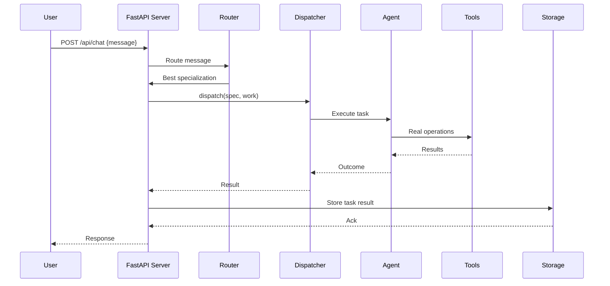

# AGOS Agent Civilization - Data Flow Analysis

**Generated:** 2026-07-23

---

## Overview

This document traces the flow of data through the AGOS system from user input to result output.

---

## Request Flow Diagram



---

## Detailed Data Flows

### Flow 1: Task Creation

```
User Request
    │
    ▼
┌─────────────────────────────────────────────────────────────┐
│ server.py: create_task()                                     │
│                                                             │
│ 1. Validate specialization                                   │
│ 2. Generate task_id (uuid)                                   │
│ 3. Create task dict: {id, spec, prompt, status, created_at}  │
│ 4. Store in TASKS dict                                       │
│ 5. Insert to storage (if configured)                        │
│ 6. Create background task: _run_task()                       │
│ 7. Return {task_id, status: "queued"}                       │
└─────────────────────────────────────────────────────────────┘
```

**Data Structure:**
```python
task = {
    "id": "abc123",
    "specialization": "analyst",
    "prompt": "Analyze sales data",
    "status": "queued",
    "created_at": 1700000000.0,
    "result": None
}
```

---

### Flow 2: Task Execution

```
Background Task: _run_task()
    │
    ▼
┌─────────────────────────────────────────────────────────────┐
│ 1. Pick agent (_pick_agent)                                 │
│ 2. Update status: "running"                                 │
│ 3. Get agent reference                                      │
│ 4. Call agent.execute({prompt, data})                       │
│ 5. Wait for result                                         │
│ 6. Update status: "completed" or "failed"                   │
│ 7. Store result                                            │
│ 8. Update agent stats                                      │
│ 9. Emit event to TASK_EVENTS queue                        │
└─────────────────────────────────────────────────────────────┘
```

---

### Flow 3: Agent Execution

```
agent.execute(work)
    │
    ▼
┌─────────────────────────────────────────────────────────────┐
│ real_agents.py: RealSpecialistAgent.execute()              │
│                                                             │
│ 1. Record start time                                       │
│ 2. Set status: "working"                                   │
│ 3. Call _dispatch(specialization, work)                    │
│ 4. Process result                                          │
│ 5. Update stats                                            │
│ 6. Set status: "idle"                                     │
│ 7. Return outcome                                          │
└─────────────────────────────────────────────────────────────┘
```

---

### Flow 4: Real Dispatch

```
_dispatch(specialization, work)
    │
    ▼
┌─────────────────────────────────────────────────────────────┐
│ real_dispatcher.py                                         │
│                                                             │
│ Match specialization to handler:                           │
│ - analyst → statistics handler                             │
│ - builder → action extraction                              │
│ - surgeon → AST diagnostics                                │
│ - researcher → web search                                  │
│ - test_runner → subprocess execution                       │
│ ...                                                        │
└─────────────────────────────────────────────────────────────┘
```

---

### Flow 5: Chat Routing

```
POST /api/chat {message}
    │
    ▼
┌─────────────────────────────────────────────────────────────┐
│ 1. Get LLM instance (get_llm)                             │
│ 2. If LLM available:                                      │
│    a. Call LLM with ROUTER_SYSTEM prompt                   │
│    b. Extract specialization from response                  │
│ 3. Else: Default to "communicator"                        │
│ 4. Pick agent and execute                                  │
│ 5. Store result                                            │
│ 6. Return {task_id, routed_to, outcome}                    │
└─────────────────────────────────────────────────────────────┘
```

**Router Prompt:**
```python
ROUTER_SYSTEM = """
You are the dispatcher of an AI agent civilization with 
these specializations: analyst, architect, builder, ...
Given a user command, reply with ONLY the single best 
specialization name from the list, nothing else.
"""
```

---

### Flow 6: Event Streaming

```
GET /api/events/stream
    │
    ▼
┌─────────────────────────────────────────────────────────────┐
│ StreamingResponse generator()                              │
│                                                             │
│ while True:                                                │
│   event = await TASK_EVENTS.get()  # Block on queue        │
│   yield f"data: {json.dumps(event)}\n\n"                  │
│                                                             │
│ Events emitted:                                            │
│ - task_created                                            │
│ - task_started                                             │
│ - task_completed                                           │
│ - heartbeat (every 30s)                                    │
└─────────────────────────────────────────────────────────────┘
```

---

### Flow 7: Storage Operations

```
Storage Interface
    │
    ├─── Supabase (if configured)
    │    │
    │    ├── insert_task()
    │    ├── update_task()
    │    ├── insert_event()
    │    ├── upsert_agent_stats()
    │    └── get_tasks()
    │
    └─── In-Memory (fallback)
         │
         ├── TASKS dict
         └── TASK_EVENTS queue
```

---

## Data Transformations

### Input → Internal

```python
# User Input (string)
message = "Analyze sales data"

# Internal Work Dict
work = {
    "prompt": "Analyze sales data",
    "data": None  # or user-provided data
}
```

### Internal → Output

```python
# Internal Result
result = {
    "analysis": {...},
    "metrics": {...}
}

# API Response
response = {
    "ok": True,
    "agent": "analyst_0000",
    "elapsed_s": 3.5,
    "result": result
}
```

---

## State Transitions

### Task State Machine

```
    ┌─────────┐
    │ queued  │ ◄─────────────────────────────────┐
    └────┬────┘                                   │
         │                                        │
         ▼                                        │
    ┌─────────┐                                   │
    │ running │                                   │
    └────┬────┘                                   │
         │                                        │
    ┌────┴────┐                                   │
    │         │                                   │
    ▼         ▼                                   │
┌───────┐ ┌────────┐                              │
│completed│ │ failed │ ───────────────────────────┘
└────────┘ └────────┘
```

### Agent State Machine

```
    ┌────────┐
    │  idle  │ ◄─────────────────────────┐
    └────┬───┘                           │
         │                               │
         ▼                               │
    ┌─────────┐                          │
    │ working │ ─────────────────────────┘
    └─────────┘
```

---

## Event Flow

```
┌─────────────────────────────────────────────────────────────┐
│                    Event Flow                               │
└─────────────────────────────────────────────────────────────┘

User Request
    │
    ├──► TASK_EVENTS.put({type: "task_created"})
    │
    ▼
Background Task Starts
    │
    ├──► TASK_EVENTS.put({type: "task_started"})
    │
    ▼
Task Completes
    │
    ├──► TASK_EVENTS.put({type: "task_completed"})
    │
    ▼
Storage Inserted
    │
    └──► storage.insert_event()
```

---

## Data Persistence

### Task Data Flow

```
In-Memory (Always)
    │
    ├── TASKS dict (max 500)
    │
    ▼
Supabase (if configured)
    │
    ├── tasks table
    ├── events table
    └── agent_stats table
```

---

## Error Data Flow

```
Exception Occurs
    │
    ▼
┌─────────────────────────────────────────────────────────────┐
│ try:                                                       │
│   outcome = await agent.execute()                          │
│ except Exception as exc:                                   │
│   outcome = {                                              │
│       "ok": False,                                         │
│       "error": f"{type(exc).__name__}: {exc}"             │
│   }                                                        │
└─────────────────────────────────────────────────────────────┘
    │
    ▼
Update Task Status
    │
    ├── task["status"] = "failed"
    └── task["result"] = outcome
```

---

## Summary

| Flow | Description |
|------|-------------|
| Request | User → API → Dispatcher → Agent |
| Execution | Agent → Tools → Result |
| Response | Result → API → User |
| Events | TASK_EVENTS queue → SSE stream |
| Storage | In-memory + Supabase |

---

*Report generated as part of comprehensive repository analysis*
