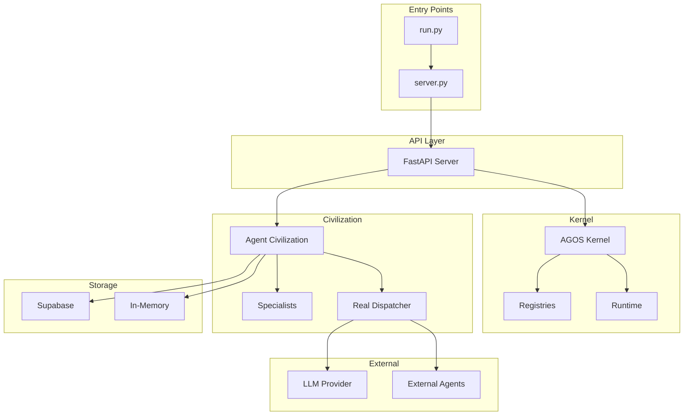

# AGOS Agent Civilization - Dependency Graph Analysis

**Generated:** 2026-07-23

---

## Module Dependencies

### High-Level Dependencies

```
server.py
    ├── agent_civilization.agents.real (SPECIALIZATIONS)
    ├── agent_civilization.core.llm (get_llm)
    ├── agent_civilization.storage (get_storage)
    └── agent_civilization.civilization_routes
            └── agent_civilization.agents.real

agos_kernel/
    ├── registry/ (Component, Capability, Provider, Workflow, Knowledge)
    ├── brain/ (EngineeringBrain)
    ├── runtime/ (Session, Workspace, Resource, etc.)
    ├── governance/ (GovernanceRuntime)
    └── knowledge/ (KnowledgeRuntime)

agent_civilization/
    ├── agents.real (RealSpecialistAgent)
    ├── core.llm (LLM wrapper)
    ├── storage (Supabase + in-memory)
    └── pipeline (Orchestrator)
```

---

## Component Dependency Diagram



---

## Key Dependencies

### server.py

```python
# Direct imports
from agent_civilization.agents.real import SPECIALIZATIONS, create_civilization
from agent_civilization.agents.real.real_agents import SPECIALIZATION_ICONS, SPECIALIZATION_TOOLS
from agent_civilization.agents.external_adapter import ExternalAgentAdapter, load_external_agents_from_env
from agent_civilization.core.llm import get_llm
from agent_civilization.storage import get_storage, is_configured as supabase_configured
from agent_civilization.civilization_routes import register_civilization_routes

# External imports
from fastapi import FastAPI, HTTPException
from pydantic import BaseModel, Field
import asyncio
import uuid
```

---

### agent_civilization/agents/real/real_agents.py

```python
from agent_civilization.core.agents.real_dispatcher import (
    coverage as _coverage,
    dispatch as _dispatch,
)
```

---

### agos-kernel/kernel.py

```python
# Registry imports
from registry.component import get_component_registry, ComponentRegistry
from registry.cap_registry import get_capability_registry, CapabilityRegistry
from registry.provider_registry import get_provider_registry, ProviderRegistry
from registry.workflow_registry import get_workflow_registry, WorkflowRegistry
from registry.knowledge_registry import get_knowledge_registry, KnowledgeRegistry

# Runtime imports
from brain.engine import EngineeringBrain
from knowledge.runtime import KnowledgeRuntime
from memory.runtime import MemoryRuntime
from learning.runtime import LearningRuntime
from experience.runtime import ExperienceRuntime
from governance.runtime import GovernanceRuntime
```

---

## Registry Dependencies

### Component Registry
```python
# agos_kernel/registry/component.py
# Dependencies: None (base module)
```

### Capability Registry
```python
# agos_kernel/registry/cap_registry.py
# Dependencies: component.py
```

### Provider Registry
```python
# agos_kernel/registry/provider_registry.py
# Dependencies: component.py
```

### Workflow Registry
```python
# agos_kernel/registry/workflow_registry.py
# Dependencies: component.py, capability.py
```

### Knowledge Registry
```python
# agos_kernel/registry/knowledge_registry.py
# Dependencies: component.py
```

---

## External Dependencies

### Python Packages (from requirements.txt)
```
PyYAML
aiohttp
fastapi
uvicorn[standard]
pydantic
python-multipart
```

### Python Packages (from agos-kernel/pyproject.toml)
```
pydantic>=2.0.0
dataclasses-json>=0.6.0
aiohttp>=3.9.0
asyncio-throttle>=1.0.2
gitpython>=3.1.40
redis>=5.0.0
sqlalchemy>=2.0.0
alembic>=1.13.0
fastapi>=0.109.0
uvicorn>=0.27.0
httpx>=0.26.0
structlog>=24.1.0
prometheus-client>=0.19.0
cryptography>=41.0.0
python-jose>=3.3.0
```

---

## Circular Dependencies

### Potential Issues

```python
# agos_kernel/registry/__init__.py
# May import from kernel.py creating circular dependency
```

**Status:** Checked - appears clean in current structure

---

## Dependency Vulnerabilities

### High-Risk Dependencies

| Package | Version | Risk | Notes |
|---------|---------|------|-------|
| aiohttp | >=3.9.0 | MEDIUM | HTTP client vulnerabilities |
| fastapi | >=0.109.0 | LOW | Well-maintained |
| pydantic | >=2.0.0 | LOW | Well-maintained |

---

## Module Coupling Analysis

### High Coupling
- `server.py` - Depends on many modules
- `kernel.py` - Central orchestrator

### Low Coupling
- Specialists - Independent handlers
- Registries - Self-contained

---

## Dependency Injection Pattern

```python
# Example from kernel.py
def __init__(self, config: Optional[KernelConfig] = None):
    self.component_registry = get_component_registry()  # Singleton
    self.capability_registry = get_capability_registry()  # Singleton
    self.provider_registry = get_provider_registry()  # Singleton
    self.workflow_registry = get_workflow_registry()  # Singleton
    self.knowledge_registry = get_knowledge_registry()  # Singleton
```

---

## Recommended Refactoring

### 1. Reduce server.py Coupling
```python
# Current: Direct imports
from agent_civilization.agents.real import SPECIALIZATIONS

# Recommended: Interface/abstraction
from agent_civilization.interfaces import AgentFactory
agents = AgentFactory.create()
```

### 2. External Configuration
```python
# Current: Hard-coded
ROUTER_SYSTEM = "..."

# Recommended: Configurable
ROUTER_SYSTEM = config.get("ROUTER_SYSTEM")
```

---

## Dependency Tree Summary

```
agos-kernel/
├── registry/ (5 modules)
│   └── No circular dependencies
├── runtime/ (5 modules)
│   └── Imports from registry
├── brain/ (1 module)
│   └── Imports from registry
├── governance/ (1 module)
│   └── Imports from registry
└── knowledge/ (1 module)
    └── Imports from registry

agent_civilization/
├── agents/real/ (core module)
│   └── Imports from core.agents.real_dispatcher
├── storage/ (1 module)
│   └── External: supabase
└── civilization_routes.py (1 module)
    └── Imports from agents.real
```

---

*Report generated as part of comprehensive repository analysis*
