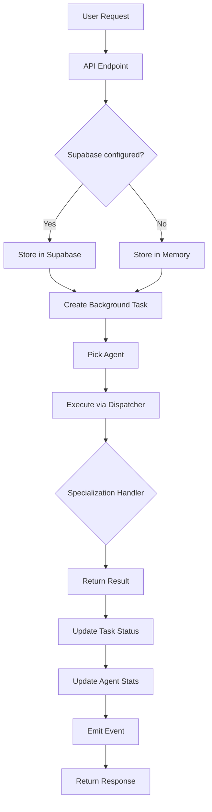

# AGOS Agent Civilization - Entry Points and Execution Flow

**Generated:** 2026-07-23

---

## Entry Points Overview

| Entry Point | Type | Purpose | Priority |
|-------------|------|---------|----------|
| `run.py` | Script | Main application entry | CRITICAL |
| `server.py` | Script | FastAPI server | CRITICAL |
| `agos-kernel/kernel.py` | Module | Kernel initialization | HIGH |
| `agos-kernel/run_kernel.py` | Script | Kernel runner | MEDIUM |

---

## Primary Entry: run.py

```bash
python run.py
```

### Flow

```
run.py
    │
    ├──► Load environment variables
    ├──► Create FastAPI app
    ├──► Register routes
    ├──► Mount static files (if exists)
    └──► Start uvicorn server
```

### Code

```python
# run.py
import uvicorn
from server import app

if __name__ == "__main__":
    uvicorn.run(
        app,
        host="0.0.0.0",
        port=int(os.environ.get("PORT", 8000)),
        log_level="info"
    )
```

---

## API Server Entry: server.py

```bash
uvicorn server:app --host 0.0.0.0 --port 8000
```

### Initialization Flow

```
server.py (module load)
    │
    ├──► Import FastAPI
    ├──► Import Pydantic models
    ├──► Import agent_civilization modules
    │
    ▼
app = FastAPI(...)
    │
    ├──► Add CORS middleware
    ├──► Create CIVILIZATION (20 × 50 agents)
    ├──► Load EXTERNAL_AGENTS
    ├──► Initialize TASKS dict
    ├──► Initialize TASK_EVENTS queue
    │
    ▼
@app.get("/api")
async def api_root():
    ...
```

### Request Processing Flow

```
HTTP Request
    │
    ▼
FastAPI Router
    │
    ├──► /api/* → System endpoints
    ├──► /api/tasks → Task management
    ├──► /api/chat → Natural language
    ├──► /civilization/* → Auto-routing
    └──► /* → Frontend (SPA fallback)
```

---

## Kernel Entry: agos-kernel/kernel.py

```python
from agos_kernel.kernel import AGOSKernel

kernel = AGOSKernel()
kernel.start()
result = kernel.execute("workflow_id", {"input": data})
```

### Kernel Initialization

```
AGOSKernel.__init__()
    │
    ├──► Create KernelConfig
    ├──► Initialize state
    ├──► Get component registry (singleton)
    ├──► Get capability registry (singleton)
    ├──► Get provider registry (singleton)
    ├──► Get workflow registry (singleton)
    ├──► Get knowledge registry (singleton)
    ├──► Initialize logging
    └──► Setup event handlers
```

### Kernel Start

```
kernel.start()
    │
    ├──► Status: BOOTSTRAPPING
    ├──► _register_builtin_components()
    ├──► _register_builtin_capabilities()
    ├──► _register_builtin_providers()
    ├──► _register_builtin_workflows()
    ├──► _activate_components()
    ├──► _initialize_knowledge()
    ├──► Start health check thread
    │
    ▼
Status: READY
```

---

## Agent Execution Entry

### Direct Execution
```python
from agent_civilization.agents.real import run_real

result = await run_real("analyst", "Analyze data")
```

### Via API
```bash
POST /api/tasks
{
  "specialization": "analyst",
  "prompt": "Analyze data"
}
```

### Via Chat
```bash
POST /api/chat
{
  "message": "Analyze our sales figures"
}
```

---

## Execution Flow: Task to Result



---

## Detailed Execution Flow

### Step 1: Task Creation
```python
# server.py: create_task()
task_id = uuid.uuid4().hex[:12]
TASKS[task_id] = {
    "id": task_id,
    "specialization": req.specialization,
    "prompt": req.prompt,
    "status": "queued",
    "created_at": time.time(),
}
asyncio.create_task(_run_task(task_id, req.specialization, req.prompt, req.data))
```

### Step 2: Task Execution
```python
# server.py: _run_task()
agent = _pick_agent(specialization)
TASKS[task_id]["status"] = "running"
TASKS[task_id]["agent"] = agent.name
outcome = await agent.execute({"prompt": prompt, "data": data})
TASKS[task_id]["status"] = "completed" if outcome["ok"] else "failed"
```

### Step 3: Agent Execution
```python
# real_agents.py: RealSpecialistAgent.execute()
started = time.time()
self.status = "working"
result = await _dispatch(self.specialization, work or {})
ok = bool(result.get("ok"))
if ok:
    self.stats["tasks_completed"] += 1
else:
    self.stats["tasks_failed"] += 1
self.status = "idle"
```

### Step 4: Dispatch
```python
# real_dispatcher.py: dispatch()
if specialization == "analyst":
    return handle_analyst(work)
elif specialization == "builder":
    return handle_builder(work)
# ... 20 specializations
```

---

## Chat Flow with LLM Routing

```
User Message
    │
    ▼
┌─────────────────────────────────────────────────────────────┐
│ POST /api/chat                                             │
│                                                             │
│ llm = get_llm()                                            │
│ if llm.available:                                           │
│     # LLM Routing                                          │
│     routed = await llm.complete(ROUTER_SYSTEM, message)    │
│     spec = extract_specialization(routed["content"])       │
│ else:                                                       │
│     # Default                                              │
│     spec = "communicator"                                  │
│                                                             │
│ agent = _pick_agent(spec)                                  │
│ outcome = await agent.execute({"prompt": message})         │
│                                                             │
│ return {task_id, routed_to: spec, outcome}                │
└─────────────────────────────────────────────────────────────┘
```

---

## Event Streaming Flow

```
GET /api/events/stream
    │
    ▼
┌─────────────────────────────────────────────────────────────┐
│ async def generate():                                       │
│     while True:                                            │
│         event = await asyncio.wait_for(                    │
│             TASK_EVENTS.get(),                              │
│             timeout=30                                      │
│         )                                                   │
│         yield f"data: {json.dumps(event)}\n\n"            │
└─────────────────────────────────────────────────────────────┘
```

---

## Frontend Entry

### Web Entry
```bash
cd web && npm run dev
```

### TanStack Start Entry
```bash
npm run dev  # From src/
```

### Build Entry
```bash
npm run build  # Creates dist/
```

---

## Background Processes

### Health Check Thread
```python
# kernel.py: _health_check_loop()
while self._running:
    time.sleep(self.config.health_check_interval)
    # Check component health
```

### Task Event Queue
```python
# server.py
TASK_EVENTS: asyncio.Queue = asyncio.Queue()
```

---

## Startup Sequence

```
1. Environment variables loaded
        │
        ▼
2. FastAPI app created
        │
        ▼
3. Middleware applied (CORS)
        │
        ▼
4. Registries initialized (singletons)
        │
        ▼
5. Civilization created (1000 agents)
        │
        ▼
6. External agents loaded (if configured)
        │
        ▼
7. Routes registered
        │
        ▼
8. Frontend mounted (if dist exists)
        │
        ▼
9. Uvicorn server starts
        │
        ▼
10. Ready to accept requests
```

---

## Shutdown Sequence

```
1. SIGTERM/SIGINT received
        │
        ▼
2. Uvicorn stops accepting connections
        │
        ▼
3. In-flight tasks complete (or timeout)
        │
        ▼
4. Kernel shutdown:
        │
        ├──► Stop health check thread
        ├──► Deactivate components
        └──► Emit SHUTDOWN event
        │
        ▼
5. Server stops
```

---

## Error Handling Flow

```
Exception Occurs
        │
        ▼
┌─────────────────────────────────────────────────────────────┐
│ try:                                                       │
│     result = await agent.execute()                         │
│ except Exception as exc:                                    │
│     result = {                                             │
│         "ok": False,                                       │
│         "error": f"{type(exc).__name__}: {exc}"           │
│     }                                                      │
└─────────────────────────────────────────────────────────────┘
        │
        ▼
Update Task Status: "failed"
        │
        ▼
Return Error Response
```

---

## Summary

| Entry Point | Type | Flow |
|-------------|------|------|
| `run.py` | Main | Environment → App → Server |
| `server.py` | API | Routes → Handlers → Agents |
| `kernel.py` | Core | Registries → Components → Workflows |
| `/api/chat` | HTTP | Message → LLM → Agent → Result |
| `/api/tasks` | HTTP | Task → Queue → Agent → Result |

---

*Report generated as part of comprehensive repository analysis*
